<!-- Perfil do GitHub · Caiosmp -->

 

 

## Sobre

Comecei com projetos menores e fui pegando gosto por entender o que acontece por trás de uma aplicação: a organização do código, a persistência dos dados, as permissões e as integrações.

Já desenvolvi **bots para Discord**, sistemas de cadastro e **automações que tiram tarefas repetitivas do caminho**. Hoje meu foco está em **backend, aplicações web e segurança de software**.

 

## Projetos

<table>
  <tr>
    <th width="33%" align="left">Multi-tenant</th>
    <th width="33%" align="left">Segurança</th>
    <th width="34%" align="left">Pagamentos e operação</th>
  </tr>
  <tr>
    <td valign="top">
      
      Cada loja com catálogo, equipe, clientes e pagamentos isolados  
      Subdomínio próprio e domínio personalizado com verificação por TXT e HTTPS automático  
      Nome, cores, domínio e produtos são configuração, não código
      
    </td>
    <td valign="top">
      
      Refresh token rotativo com detecção de reuso  
      2FA por e-mail com limite de tentativas e confirmação de senha em ações sensíveis  
      Cargos OWNER, MANAGER e STAFF, exceções por pessoa e auditoria do painel  
      CPF nunca salvo em texto puro
      
    </td>
    <td valign="top">
      
      Pix via Mercado Pago e cartão via Stripe Connect  
      Webhooks com validação de assinatura e idempotência  
      Reembolso total ou parcial, expiração de pedidos e nota fiscal via NFe.io  
      Importação por CSV, entrega de produtos digitais e backup com dados mascarados
      
    </td>
  </tr>
</table>

  
<b>Decisões de projeto e stack completa</b>

   

- **Lojista e comprador são contas completamente separadas.**
- **Pedidos guardam uma cópia do que foi comprado**, então alterar um produto não muda o histórico de vendas.
- **Permissões sem cache, por enquanto.**
- **Proteção em camadas nos endpoints públicos.**
- **Variáveis de ambiente validadas com Zod** na inicialização da API.

| Camada | Tecnologias |
|:--|:--|
| Backend | NestJS 11 · TypeScript · Prisma 7 · PostgreSQL (Supabase) |
| Frontend | Next.js 16 · React 19 |
| Infra | Vercel · Supabase Storage · Resend · Cloudflare Turnstile |
| Pagamentos e fiscal | Mercado Pago · Stripe Connect · NFe.io |
| Testes | Jest · Vitest |

 

  
  
  
  

> [!NOTE]
> Também colaboro no [**Nexo**](https://github.com/DevGuijas/Nexo), um aplicativo de suporte e diagnóstico para Windows, com issues, pull requests e revisão de código em equipe.

 

## Stack

<table>
  <tr>
    <td width="50%" valign="top">
      <b>LINGUAGENS</b>  
      
    </td>
    <td width="50%" valign="top">
      <b>FRAMEWORKS</b>  
      
    </td>
  </tr>
  <tr>
    <td width="50%" valign="top">
      <b>DADOS</b>  
      
    </td>
    <td width="50%" valign="top">
      <b>FERRAMENTAS</b>  
      
    </td>
  </tr>
  <tr>
    <td width="50%" valign="top">
      <b>IA NO DIA A DIA</b>  
      
    </td>
    <td width="50%" valign="top">
      <b>GESTÃO</b>  
      
    </td>
  </tr>
</table>

 

## Em números

Atualizado automaticamente a partir da minha atividade no GitHub.

  
  
    
  

  
<b>Ver gráfico de atividade dos últimos 30 dias</b>

   
  

